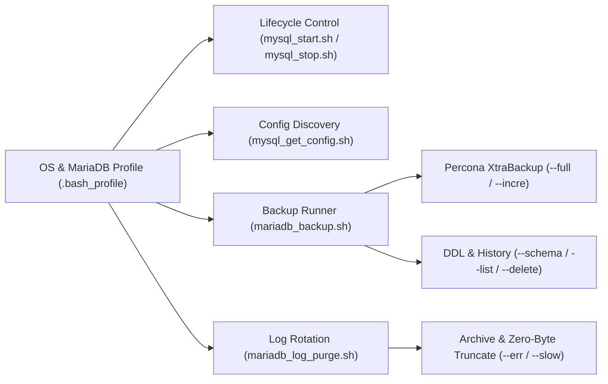

# mariadb-dba-scripts

Operational shell scripts for MariaDB 10.x lifecycle control, environment discovery, Percona XtraBackup physical and logical backups, and log rotation.

## Script Overview



## Components

- [`.bash_profile`](.bash_profile): Sample DBA shell profile setting `MARIADB_BASE`, `PATH`, and `mysql3306` / `nmon` aliases.
- [`mysql_start.sh`](mysql_start.sh): Sample wrapper invoking `mysqld_safe --defaults-file=... --user=...`.
- [`mysql_stop.sh`](mysql_stop.sh): Sample wrapper invoking `mysqladmin -uroot -pPWD -S ... shutdown`.
- [`mysql_get_config.sh`](mysql_get_config.sh): Interactive discovery script resolving `basedir`, Unix `socket`, and authenticated client variables (`mysql`, `mysqladmin`, `mysqldump`).
- [`mariadb_backup.sh`](mariadb_backup.sh): Bash runner for `--full`, `--incre`, `--schema`, `--binlog`, `--engine`, `--delete`, `--list`, and `--help` operations with CSV history tracking (`${LOG_HOME}/backup_all_history.log`).
- [`mariadb_log_purge.sh`](mariadb_log_purge.sh): Bash copy-and-truncate log rotation script for `--err`, `--slow`, and `--help`.

## Quick Configuration

Set connection and path environment variables before running [`mariadb_backup.sh`](mariadb_backup.sh) or [`mariadb_log_purge.sh`](mariadb_log_purge.sh) so passwords stay out of source files:

```bash
export DB_NAME="DBNAME"
export DB_USER="bkupusr"
export DB_PWD="replace_with_secret_from_vault"
export BACKUP_HOME="/bkup001/masvc01/${DB_NAME}"
export LOG_HOME="${BACKUP_HOME}/backup_log"
```

Every backup run appends a status line to `${LOG_HOME}/backup_all_history.log`:

```text
DBNAME,bkupusr,2016-12-20 15:10:02,2016-12-20 15:10:08,6,42,full,/bkup001/masvc01/DBNAME/DBNAME_full_20161220_1510,/bkup001/masvc01/DBNAME/backup_log/backup.db.20161220151002.log
```

## Quick Usage

### Physical, Schema, Binlog, and Retention Operations

```bash
# Show all supported flags
bash mariadb_backup.sh --help

# Run a full Percona XtraBackup snapshot
bash mariadb_backup.sh --full

# Run an incremental backup chained against the latest LSN
bash mariadb_backup.sh --incre

# Dump schema-only DDL (routines and events included, no row data)
bash mariadb_backup.sh --schema

# Sync binary logs from LOGBIN_HOME into BACKUP_HOME/binary_backup
bash mariadb_backup.sh --binlog

# Copy ENGINE_HOME and XTRABACKUP_HOME into a timestamped backup directory
bash mariadb_backup.sh --engine

# Purge backup directories and binary logs older than RESERVE_DAYS
bash mariadb_backup.sh --delete

# List on-disk full, incremental, binlog, and schema backups
bash mariadb_backup.sh --list
```

Example `--list` output:

```text
==============================================
== DBNAME Show List of backups on disk
== Started : 2016/12/20 15:23:19
==============================================
####################
# Path: /bkup001/masvc01/DBNAME/DBNAME_full_20161220_1510/
####################
backup_type = full-backuped
start_time = 2016-12-20 15:10:03
end_time = 2016-12-20 15:10:08
partial = N
incremental = N
binlog_pos = filename 'mysql-bin.000018', position '390'
```

### Error and Slow Log Rotation

```bash
# Show log-purge options
bash mariadb_log_purge.sh --help

# Copy and truncate the MariaDB error log
bash mariadb_log_purge.sh --err

# Copy and truncate the MariaDB slow query log
bash mariadb_log_purge.sh --slow
```

### Interactive Connection Discovery

```bash
./mysql_get_config.sh --help
./mysql_get_config.sh
```

## Documentation (Diataxis)

Full documentation lives under [`docs/`](docs/index.md):

- [Tutorials](docs/01-tutorials/index.md): Hands-on isolated lab exercising `--help`, `--list`, and sandbox log rotation.
- [How-To Guides](docs/02-how-to-guides/index.md): Operational procedures for backups, retention cleanup, and log rotation.
- [Reference](docs/03-reference/index.md): Script inventory, CLI flags, environment variables, defaults, and exit codes.
- [Explanation](docs/04-explanation/index.md): Backup LSN chaining, retention safety, copytruncate mechanics, and credential handling.

## Verification

Run the automated test suite from the repository root:

```bash
python -m unittest discover -s tests -p "test_*.py" -v
```
