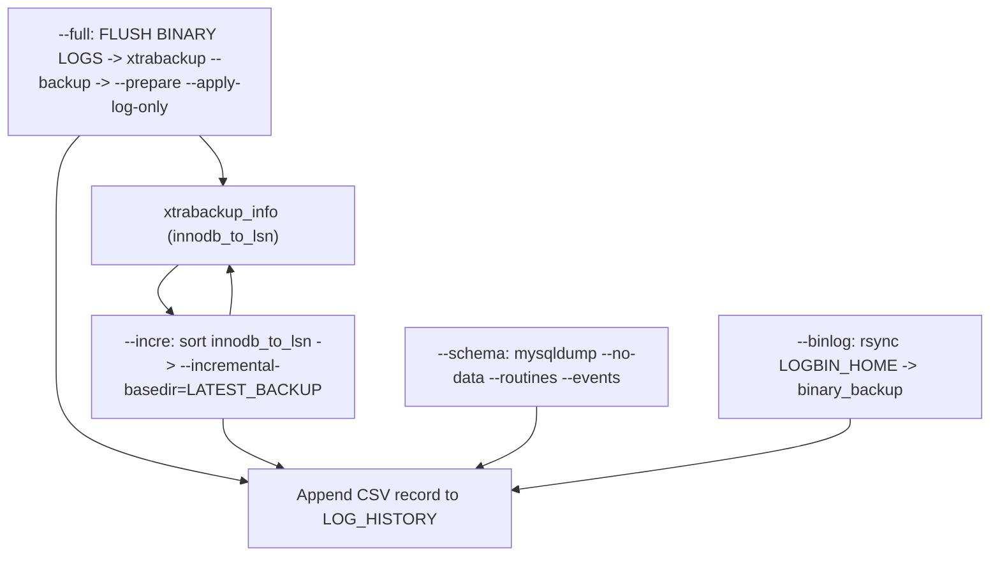

# Backup, Retention, and Purge Mechanics

This document explains how `mariadb_backup.sh` and `mariadb_log_purge.sh` sequence backup chains, enforce retention boundaries, and rotate logs on disk.

## Physical and Logical Backup Workflow



`mariadb_backup.sh` combines four distinct backup mechanisms under a single log-tracked entrypoint:

- **Full backup (`--full`)** flushes MariaDB binary logs first, takes an XtraBackup snapshot, copies `MY_CNF`, and runs `--prepare --apply-log-only`. Preparing with `--apply-log-only` rolls forward committed redo transactions cleanly while keeping uncommitted undo behavior compatible with subsequent incremental deltas.
- **Incremental backup (`--incre`)** scans `${BACKUP_HOME}` for every `xtrabackup_info` file, sorts numerically by `innodb_to_lsn`, selects the highest LSN directory, and passes it as `--incremental-basedir`. Unlike timestamp sorting on directory names, `innodb_to_lsn` guarantees the delta chains from the exact highest checkpoint recorded by InnoDB.
- **Schema (`--schema`), binlog (`--binlog`), and engine (`--engine`)** capture orthogonal recovery artifacts: DDL structure (`mysqldump --no-data`), point-in-time binary log files (`rsync -av`), and exact software directories (`ENGINE_HOME` and `XTRABACKUP_HOME`).

## Retention Safety (`-mindepth 1` and Quoting)

File retention via `find` carries an inherent blast-radius risk if the root directory matches its own age predicate. Previously, `fn_delete_backups` evaluated:

```bash
find ${BACKUP_HOME} -maxdepth 1 -type d -mtime +${RESERVE_DAYS}
```

In GNU and POSIX `find`, depth `0` is the starting path `${BACKUP_HOME}` itself. If no subdirectory was created or updated directly inside `${BACKUP_HOME}` within `RESERVE_DAYS`, `find` emitted `${BACKUP_HOME}` and passed it unquoted to `rm -rf`.

Adding explicit `[ -n "${BACKUP_HOME}" ] && [ -d "${BACKUP_HOME}" ]` guards, `-mindepth 1`, and double-quoted `"${BACKUP_NAME}"` removes depth `0` from deletion candidates so cleanup only evaluates immediate child directories and files under `${BACKUP_HOME}/binary_backup`.

## Copytruncate Log Rotation Trade-Offs

MariaDB keeps open file descriptors to `mysqld.err` and the slow query log across server uptime. Moving or unlinking an active log file frees directory entries without freeing disk space until MariaDB reopens file handles (`FLUSH LOGS` or restart).

`mariadb_log_purge.sh` therefore follows the copytruncate model:

1. Copies the active log file to a dated hourly snapshot (`LOG_NAME.YYYYMMDD_HH`).
2. Truncates the live file in place to zero bytes using `: > "${LOG_HOME}/${LOG_NAME}"` (preserving the inode).

Using `: >` avoids the stray 1-byte newline (`0x0a`) left by `echo '' >`. The trade-off of copytruncate is a brief window between `cp` and `: >` during which newly emitted log lines can be lost before truncation completes, whereas expired hourly files (`-mindepth 1 -maxdepth 1 -type f -mtime +RESERVE_DAYS`) are printed for operator review rather than auto-removed until `#rm -rf` is enabled.

## Credential Hygiene

Passing `--password=${DB_PWD}` on child process command lines exposes secrets in host process listings (`ps`). Defaulting `DB_PWD` to an empty string (`${DB_PWD:-}`) keeps plaintext passwords out of version control and allows operators to inject credentials via runtime environment variables or client option groups (`~/.my.cnf`) rather than committing secrets into scripts or documentation.
