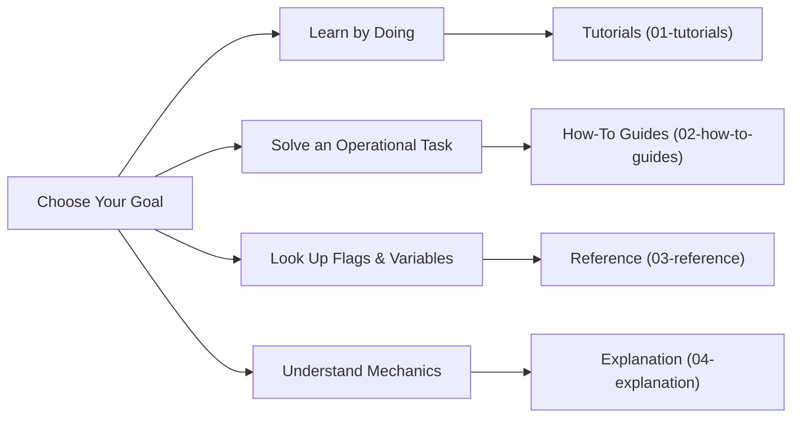

# MariaDB DBA Scripts Documentation

This documentation set follows the Diataxis architecture for [`mariadb-dba-scripts`](../README.md).

## Documentation Quadrants

| Quadrant | Purpose | Entry Point |
| :--- | :--- | :--- |
| Tutorials | Guided sandbox lab without a live database server | [01-tutorials/index.md](01-tutorials/index.md) |
| How-To Guides | Step-by-step operational procedures in ASD-STE100 | [02-how-to-guides/index.md](02-how-to-guides/index.md) |
| Reference | CLI options, environment variables, defaults, exit codes | [03-reference/index.md](03-reference/index.md) |
| Explanation | Design rationale, LSN chaining, copytruncate trade-offs | [04-explanation/index.md](04-explanation/index.md) |
